<p align="center">
  
</p>

<h1 align="center">OmniFi</h1>

<p align="center"><b>See your UniFi network at a glance — and just ask it questions.</b> A <a href="https://base44.com">Base44</a> app that turns the UniFi API into a live dashboard plus an AI assistant, all behind your login.</p>

<p align="center">
  
  
  
  
  
</p>

---

## What it is

OmniFi is a single pane of glass for a UniFi network. The frontend (React + Vite, shadcn/ui) renders live dashboards — clients, devices, networks, Wi-Fi, security and WAN health — and a chat panel lets you ask questions in plain language, answered from your actual network data. Two Base44 serverless functions sit behind it: `unifiProxy` (an **admin-gated** proxy to the UniFi API) and `unifiChat` (the assistant).

## The app

<p align="center">
  
</p>

| Page | What it shows |
|---|---|
| **Dashboard** | stat cards, device-health gauge, client donut, recent events |
| **Insights** | traffic, AP health, channel utilization, clients by band/signal |
| **Clients** / **Devices** | sortable tables, signal, adoption status |
| **Networks** / **WiFi** / **Zones** | VLANs & subnets, SSIDs & radios, firewall zones |
| **Security** / **Gateway** | alarms & threats, WAN & ISP metrics |
| **Terminal** | a raw UniFi API console |
| **Chat** | ask your network anything |
| **Settings** | app config & auth |

## How data flows

```
React UI  →  unifiProxy (Base44 fn)  →  https://api.ui.com
                   │
                   ├─ requires a signed-in Base44 user
                   └─ requires role: admin   (401 / 403 otherwise)
```

The UniFi `X-API-Key` lives only in the function's environment (`UNIFI_API_KEY`) — it never reaches the browser. Every proxied call is gated on an authenticated **admin** Base44 user, so the dashboard can't be used to reach your network without a login.

## Run it locally

```bash
git clone <this repo>
cd unifi-base44
npm install
```

Create `.env.local`:

```bash
VITE_BASE44_APP_ID=your_app_id
VITE_BASE44_APP_BASE_URL=https://your-app.base44.app
```

Then:

```bash
npm run dev
```

Any change pushed to this repo is also reflected in the Base44 Builder; publish from [Base44.com](https://base44.com). Set `UNIFI_API_KEY` as a backend environment variable in Base44 (not in `.env.local`).

## Project layout

```
src/pages/           # the 12 pages above
src/components/
  dashboard/         # stat cards, gauges, donut, tables, event feed
  insights/          # traffic / AP health / channel / signal charts
  chat/              # ChatPanel
  ui/                # shadcn/ui primitives
src/api/base44Client.js
base44/functions/
  unifiProxy/        # admin-gated proxy → api.ui.com
  unifiChat/         # AI assistant
```

## Docs & support

Base44 GitHub integration: [docs.base44.com](https://docs.base44.com/Integrations/Using-GitHub) · Support: [app.base44.com/support](https://app.base44.com/support).

<!-- org-footer -->
---

<p align="center"><sub>Part of <a href="https://github.com/ry-ops">ry-ops</a> · building the pipes between infrastructure, automation, and observability · built by <a href="https://github.com/ry-ops">ry-ops</a></sub></p>
